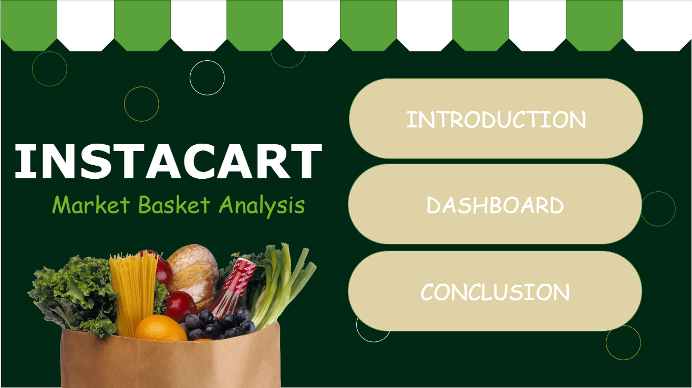
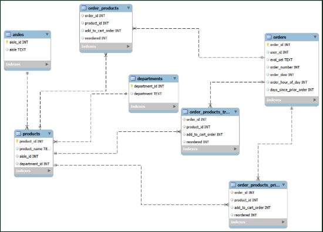
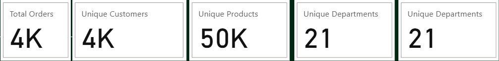
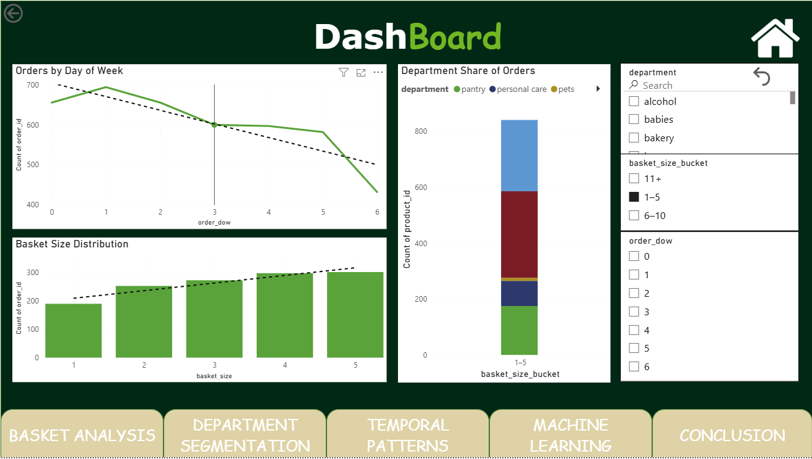
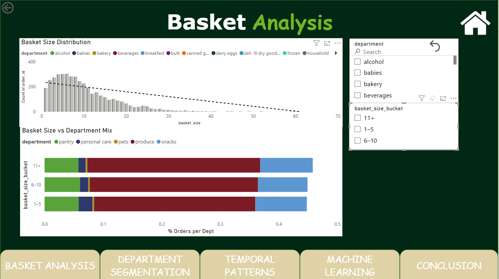
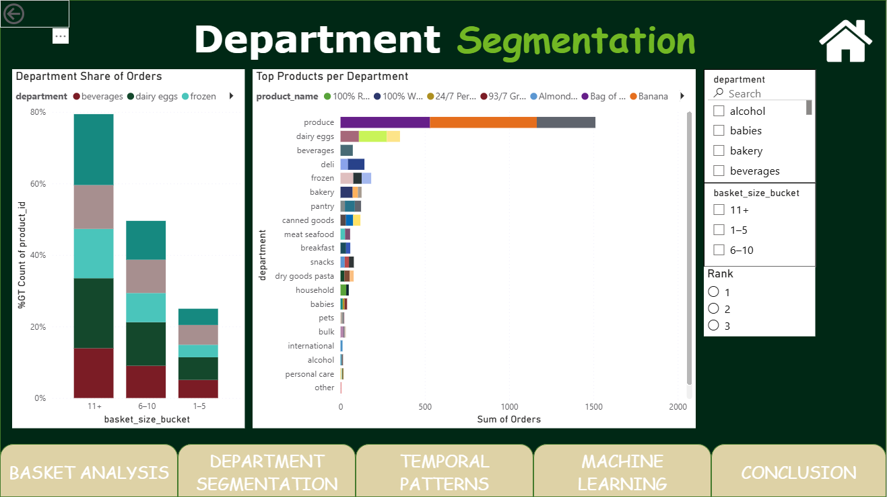
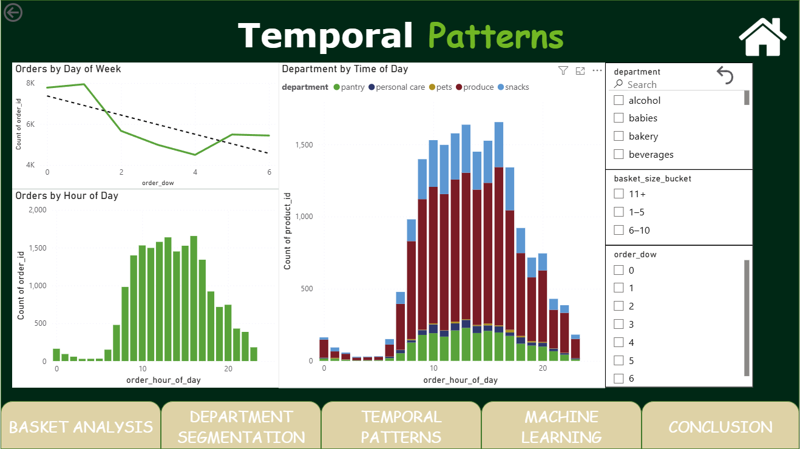
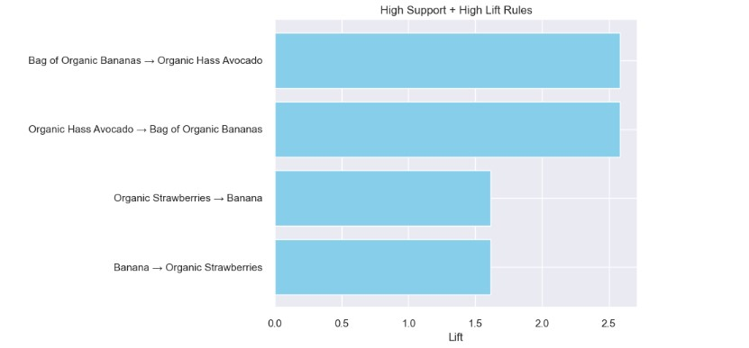
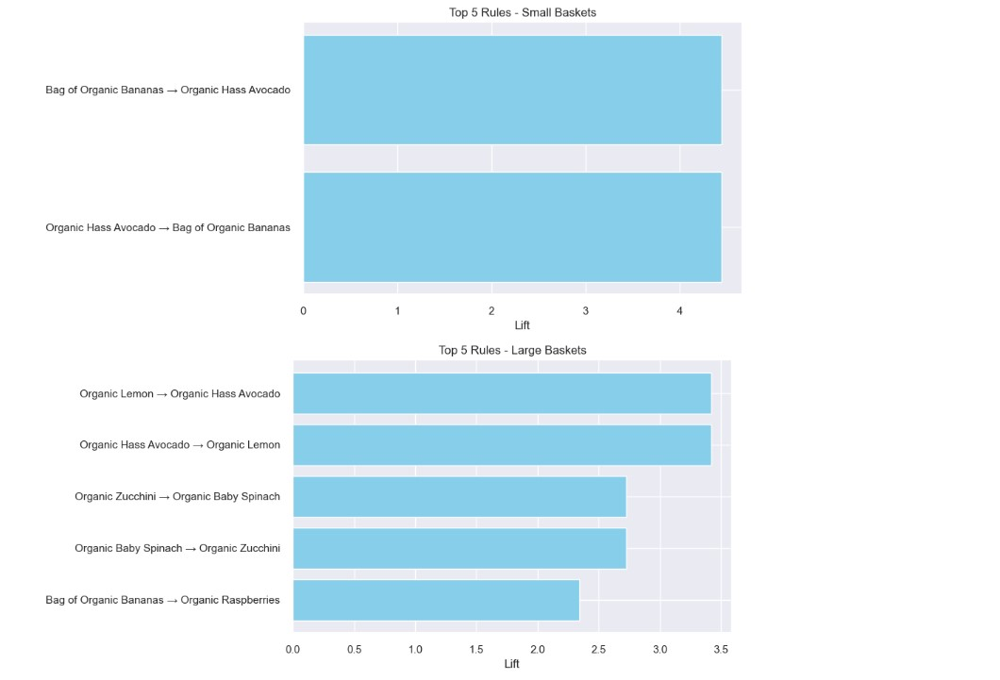

# Instacart Market Basket Analysis

**Power BI dashboard + association-rule mining to show which products drive orders, how basket size shapes the department mix, and what to cross-sell.**




---

## Business Question

> With thousands of products across multiple departments, how can we identify which items drive the most orders and customer engagement?

Instacart connects customers with local stores for same-day delivery or pickup. Knowing what sits in a basket, and what gets bought together, directly informs inventory, promotions and recommendations.

## Objectives

1. Identify **top-selling products per department**.
2. Understand **customer purchasing behavior** (staples vs. impulse buys).
3. Provide actionable insights for **inventory management and marketing strategy**.
4. Build an **interactive dashboard** so stakeholders can explore product performance themselves.

---

## Key Findings

| # | Finding | Impact |
|---|---------|--------|
| 1 | Most baskets hold **5-15 items**, with a sharp drop after 20+. Large baskets (11+) still hold the most traffic throughout the week, followed by Medium baskets (6-10) then Small Baskets (1-5) | Promotions should be built around the 5-15 item trip |
| 2 | **Produce** consistently drives the highest order counts across departments | Produce is the anchor department for any campaign |
| 3 | Small baskets (1-5) lean to **snacks, personal care, quick-need items**; medium baskets (6-10) mix **pantry staples and produce**; large baskets (11+) are dominated by **produce and snacks** | Small baskets are upsell targets; large baskets are planned, full-stock trips |
| 4 | **Dairy & Eggs** and **Beverages** are strong secondary departments; smaller departments (personal care, pets, alcohol) appear mostly in small baskets | Use dairy and beverages as secondary traffic drivers; use small baskets to lift the smaller departments |
| 5 | Orders peak **mid-morning to early afternoon**, and produce and snacks dominate those hours. The week's peak is **Day 1**, the low is **Day 4** | Time produce and snack offers to the peak window and early week |
| 6 | Association rules show strong pairings (e.g. bananas ↔ avocado, strawberries ↔ frozen blueberries, flavored sparkling waters) | Direct input for "Frequently Bought Together" |

---

## Data and Model

**Source:** Instacart Market Basket dataset (orders, products, aisles, departments).

**Source tables:** `orders`, `order_products` (prior and train), `products`, `aisles`, `departments`
**Power BI model tables:** `RawData`, `OrdersProductsFull`, `BasketSizes`, `departments`, `Top3ProductsByDept`


<!-- IMAGE 02: Schema / ERD (the Schema.png embedded in the "Data Set and Model" page) -->

**What this shows:** `orders` links to line items through `order_id`; `products` links to `aisles` and `departments`. That chain lets any order be sliced by department, aisle, day and hour.


<!-- IMAGE 03: "Data Set and Model" page, top-level view of the data (raw data preview table + summary counts for orders, customers, products, departments) -->

---

## Dashboard Walkthrough

### 1. Dashboard (overview)


<!-- IMAGE 04: "Dashboard" page. Orders by day of week, basket size distribution, basket-size bucket by department, with slicers -->

**Impact:** Single view of order volume by weekday and basket size. Slicers (department, basket-size bucket, day of week) let stakeholders isolate any segment.

### 2. Basket Analysis


<!-- IMAGE 05: "Basket Analysis" page. Orders by basket size, % of orders per department by basket bucket -->

**Impact:** Shows how department mix shifts as baskets grow. This is the basis for targeting **upsizing** in small baskets and reinforcing **planned-trip** combos in large ones.

### 3. Department Segmentation


<!-- IMAGE 06: "Department Segmentation" page. Top 3 products per department + department share by basket bucket -->

**Impact:** Surfaces the top 3 products in each department, so inventory and promotion priorities are set at product level, not just department level.

### 4. Temporal Patterns


<!-- IMAGE 07: "Temporal Patterns" page. Orders by day of week, by hour of day, department by hour -->

**Impact:** Identifies when customers order and what they buy at each hour. Produce and snacks dominate the peak window, which is when to push those offers.

> **Note:** Day-of-week is shown as a numeric code (`order_dow`). Confirm the encoding (0 = Sunday vs. Monday) before quoting weekday names externally.

---

## Machine Learning: Association Rules

Association-rule mining (support and **lift**) was used to find products that are bought together more often than chance. A lift above 1 means a real pairing; higher means stronger.

### Overall: high support + high lift


<!-- IMAGE 08: "Machine Learning" page, left chart (High Support + High Lift Rules) -->

**Impact:** Bananas ↔ Avocado (lift ≈ 2.6) and Strawberries ↔ Banana (lift ≈ 1.6) are common *and* meaningful pairings, making them safe candidates for recommendation slots.

### By basket size


<!-- IMAGE 09: "Machine Learning" page, right chart (Top 5 Rules - Small Baskets / Large Baskets) -->

**Impact:**
- **Small baskets:** Bananas ↔ Avocado is very strong (lift ≈ 4.4). Shoppers on short trips buy tight pairs, so bundle them.
- **Large baskets:** Lemon ↔ Avocado, Zucchini ↔ Baby Spinach, Bananas → Raspberries. Larger trips show broader fresh-produce combinations.

### By department


<!-- IMAGE 10: "Departmental Rules" page (Produce, Beverages, Frozen rule charts, side by side or as a 3-image strip) -->

| Department | Strongest pairing | Approx. lift | Impact |
|-----------|-------------------|--------------|--------|
| Produce | Bananas ↔ Raspberries | ~2.2 | Fresh-fruit cross-sell |
| Beverages | Sparkling Lemon Water ↔ Lime Sparkling Water | ~6.2 | Multi-flavor sparkling water bundles |
| Frozen | Organic Whole Strawberries ↔ Frozen Organic Wild Blueberries | ~7.2 | Fresh + frozen fruit pairing for health-focused shoppers |

---

## Recommendations

| Area | Action | Expected Impact |
|------|--------|-----------------|
| **Basket-size targeting** | Snack + beverage bundles for small baskets; produce + pantry combos for large baskets | Larger small baskets; protected planned trips |
| **Cross-selling** | "Frequently Bought Together" driven by the ML rules above | Higher items per order |
| **Dairy & Eggs** | Curated bundles (milk + bread, eggs + bacon); place beside pantry staples | Stronger co-purchase patterns |
| **Time-based promotions** | Produce and snack offers during **10 AM - 3 PM**; weekly "Day 1" campaigns | Capture peak demand windows |
| **Department strategy** | Produce as anchor; beverages and dairy secondary; lift personal care, pets, alcohol in small-basket campaigns | Diversified sales |

---

## Tools

- **Power BI Desktop**: modeling, DAX measures, interactive dashboard
- **Python**: association-rule mining (support, lift) 
- **SQL schema**: source tables shown in the ERD

## Repository Structure

```
.
├── Instacart-BasketAnalysis.pbix
├── README.md
└── images/
    ├── 01_homepage.png
    ├── 02_data_model.png
    ├── 03_data_overview.png
    ├── 04_dashboard.png
    ├── 05_basket_analysis.png
    ├── 06_department_segmentation.png
    ├── 07_temporal_patterns.png
    ├── 08_rules_overall.png
    ├── 09_rules_basket_size.png
    └── 10_rules_departments.png
```

## How to Use

1. Open `Instacart-BasketAnalysis.pbix` in Power BI Desktop.
2. Use the home button on each page to navigate.
3. Filter with the **department**, **basket-size bucket** and **day-of-week** slicers.

## Author

**[Mathew Maranan]**
